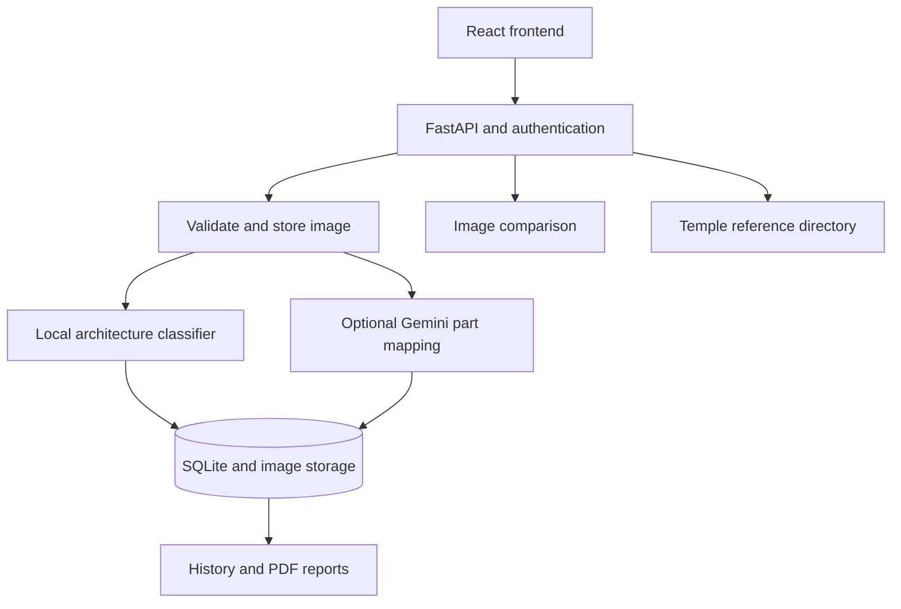

# Temple-Architecture-Classification.
Temple Atlas — Temple Architecture Analysis
A web application for studying Nagara, Dravida, and Vesara temple architecture from photographs. Temple Atlas combines a React interface, a FastAPI backend, a local image classifier, SQLite history, image comparison, and downloadable PDF reports.

Research prototype: The supplied numeric model artifact records 43.3% cross-validation accuracy on 150 images. Predictions need review; the project does not establish reliable identification of arbitrary temples or architectural parts.
Preview Images
Upload your preview images into an images directory and uncomment the following lines:

Generated previews are design mockups. Use screenshots from the running application when documenting its exact appearance and measured behaviour.
Overview
Users can register, sign in, upload a temple photograph, inspect a predicted architecture style, compare photographs, revisit previous analyses, and generate PDF reports. A searchable reference directory provides temple information and source links.

The frontend includes sample records for signed-out exploration. Those are demonstration content, not real account history or evidence of model performance. Real analysis, comparison, history, and report workflows require authentication.
Features Found in the Source

- Email/password registration and login.
- bcrypt password hashing and JWT access tokens.
- Logout with token revocation; password changes invalidate existing sessions.
- Profile email updates and password changes.
- JPEG, PNG, and WebP image uploads.
- Local architecture classification with ranked alternatives.
- Protected saved images and per-user prediction history.
- Two-image comparison or comparison against a saved prediction image.
- Pixel, edge/shape, directional edge-pattern, and colour-histogram similarity measurements.
- Seeded temple reference directory with search and style filters.
- PDF report generation and download.
- Optional Gemini-assisted architectural part mapping and retry on saved images.
- Dashboard, upload, comparison, history, reference, reports, and settings screens.
The reference directory does not automatically identify a specific temple from a photo. Image similarity measurements do not identify named structures such as pillars or gopurams.
Technology Stack
Layer	Technology
Frontend	React 18, Vite 6, JavaScript/JSX, CSS
UI tools	Lucide React, Recharts
Backend	Python, FastAPI, Uvicorn
Database	SQLite through Python sqlite3
Authentication	bcrypt, PyJWT
Image processing	Pillow, NumPy, scikit-image
Local classifier	HOG + RGB/HSV histogram features; cosine-neighbour scoring
Optional part mapping	Configurable Gemini vision API
PDF generation	ReportLab
Backend tests	Python unittest

The active local classifier is not a CNN, VGG16, TensorFlow, or PyTorch model. MySQL and Supabase are not the implemented storage engines.
Architecture

Local Classification Pipeline
backend/app/model.py implements the pipeline:
1. Correct EXIF orientation and convert the image to RGB.
2. Resize to 160 × 160 pixels.
3. Apply a 3 × 3 median filter and autocontrast.
4. Extract grayscale HOG features with 9 orientations, 16 × 16 pixel cells, 2 × 2 cell blocks, and L2-Hys normalization.
5. Extract 16-bin histograms for each RGB and HSV channel.
6. Concatenate 3,012 features per image and normalize vectors for cosine comparison.
7. For each class, average the top five available reference similarities.
8. Apply a temperature-based exponential normalization and select the highest-scoring class.
The displayed confidence comes from these normalized similarity scores. It is not a calibrated probability or a verified measure of historical correctness.
Model Storage and Loading
The active artifact is data/architecture_model.npz, version hog-color-prototype-v1. It contains numeric features, labels, class names, model version, and a recorded evaluation accuracy. The loader uses allow_pickle=False.

A legacy architecture_model.joblib also exists but is not loaded by the active classifier. Missing or invalid active artifacts trigger training from the configured dataset. Restart the backend after retraining to reload the model in the running process.
Dataset and Evaluation
The supplied training directory contains:
Class	Image files
DRAVIDA	50
NAGARA	50
VESARA	50
Total	150

Training uses stratified folds with seed 42. With this dataset, it evaluates five folds, then stores all reference feature vectors for inference.

The supplied artifact records accuracy 0.43333333333333335 (43.3%). This is an existing evaluation value inspected in the NPZ, not a newly reproduced result. Training code also calculates per-class precision, recall, F1, and a confusion matrix, but only aggregate accuracy is retained as evaluation metadata in the saved NPZ.

The source does not implement grouping by temple/site or duplicate-image removal before cross-validation. Dataset provenance, label quality, related views of the same temple, and independent external evaluation need review before making generalization claims.
Optional Architectural Part Mapping
Part mapping is separate from local style classification and is disabled by default. When enabled, the backend sends an uploaded image to the configured Gemini service and asks for visible, style-specific part boxes in structured output.
- Configure ENABLE_AI_PART_DETECTION=true and your own GEMINI_API_KEY.
- Output boxes are AI estimates, not verified annotations.
- No annotated temple-part dataset or measured part-detection accuracy is supplied.
- Mapping can return no parts or fail because of provider/network conditions.
- The implementation does not fabricate fallback coordinates.
- A saved analysis can request mapping again through its retry endpoint.
Provider model identifiers in the source are configurable defaults, not a guarantee of current provider availability. Select an identifier supported by your account. Enabled mapping sends images to an external service and may incur API costs; leave it disabled for local-only classification.
Repository Structure
The uploaded archive has a sana/ project root:
sana/
├── README.md
├── frontend/
│   ├── package.json
│   ├── package-lock.json
│   ├── vite.config.js
│   └── src/
│       ├── App.jsx
│       ├── api.js
│       ├── Chart.jsx
│       ├── main.jsx
│       ├── heritage.css
│       └── styles.css
├── backend/
│   ├── app/
│   │   ├── __init__.py
│   │   ├── main.py
│   │   ├── model.py
│   │   └── vision.py
│   ├── tests/
│   │   ├── test_api.py
│   │   ├── test_model.py
│   │   └── test_vision.py
│   ├── requirements.txt
│   ├── dev-requirements.txt
│   ├── train_model.py
│   └── data/
├── data/
│   ├── architecture_model.npz
│   └── architecture_model.joblib
├── dataset/
│   └── training/
│       ├── DRAVIDA/
│       ├── NAGARA/
│       └── VESARA/
└── docs/
Setup
Use two terminals: one for the backend and one for the frontend. Start from the sana directory containing backend and frontend. Dependency installation and runtime compatibility were not verified during this review.
Backend — Windows PowerShell
cd backend
python -m venv .venv
.\.venv\Scripts\python.exe -m pip install -r requirements.txt
Copy-Item .env.example .env
Copy the example only for a fresh setup; keep an existing local .env intact. Generate a stable secret for a fresh installation:
.\.venv\Scripts\python.exe -c "import secrets; print(secrets.token_urlsafe(48))"
Put the generated value in JWT_SECRET inside backend/.env. Then start:
.\.venv\Scripts\python.exe -m uvicorn app.main:app --host 127.0.0.1 --port 8000 --reload
Backend — macOS / Linux
cd backend
python3 -m venv .venv
source .venv/bin/activate
python -m pip install -r requirements.txt
cp .env.example .env
For a fresh setup, configure your own JWT secret as described above, then run:
python -m uvicorn app.main:app --host 127.0.0.1 --port 8000 --reload
Backend: http://127.0.0.1:8000
Interactive API docs: http://127.0.0.1:8000/docs
Frontend — Second Terminal
From the project root:
cd frontend
npm ci
npm run dev
For Windows PowerShell, use npm.cmd if script execution restrictions block npm.

Set frontend/.env to:
VITE_API_URL=/api
Open the URL printed by the server, normally http://localhost:5173. The supplied configuration binds to ::1; use http://[::1]:5173 if localhost resolution requires it. /api requests are proxied to http://127.0.0.1:8000.

Script detail: npm run dev first builds the app, then serves the compiled output with Vite preview. It does not provide hot reload. Restart the command after source changes. Scripts also use --configLoader native, so use a compatible Node/Vite environment.

Alternatively:
npm run build
npm run preview
Backend Configuration
The backend loads backend/.env before reading model and server settings. Existing shell variables take precedence. Relative data paths resolve from backend/.
Variable	Default / purpose
DATABASE_PATH	data/architecture.db
UPLOAD_DIR	data/uploads
REPORT_DIR	data/reports
JWT_SECRET	Stable secret of at least 32 characters; generated at development startup if absent/short
ENVIRONMENT	Production startup rejects a short or missing secret
JWT_EXPIRE_MINUTES	60
MAX_UPLOAD_MB	10
CORS_ORIGINS	localhost and 127.0.0.1 on port 5173
ARCHITECTURE_DATASET_DIR	../dataset/training
ARCHITECTURE_MODEL_PATH	../data/architecture_model.npz
ENABLE_AI_PART_DETECTION	false
GEMINI_API_KEY	Required only for enabled external mapping
GEMINI_VISION_MODEL	Configurable primary provider model
GEMINI_VISION_FALLBACK_MODELS	Comma-separated fallback model configuration
GEMINI_VISION_TIMEOUT	Request timeout, capped at 20 seconds in the current request code

Changing the JWT secret invalidates existing sessions. The frontend stores the access token in sessionStorage and attaches it to authenticated API requests.
Database
SQLite tables created/migrated during startup include:

users, temples, uploaded_images, predictions, architectural_features, comparisons, prediction_history, and revoked_tokens.

User images, comparisons, history, and reports are checked against ownership by the protected endpoints. Database, image, and PDF storage need persistent volumes when deployed.
API Routes
All paths below include their actual /api prefix. Most routes require Authorization: Bearer <access_token>; registration, login, health, and the reference directory are public.
Method	Route	Purpose
POST	/api/auth/register	Register
POST	/api/auth/login	Receive access token
POST	/api/auth/logout	Revoke current token
GET, PATCH	/api/profile	Read/update profile
POST	/api/profile/password	Change password
POST	/api/analysis/predict	Analyze multipart image
POST	/api/analysis/compare	Compare multipart reference and comparison
POST	/api/analysis/compare/{prediction_id}	Compare with a saved image
GET	/api/temples	Search/filter reference directory
GET	/api/history	Paginated owned analyses
GET	/api/history/{prediction_id}	Owned analysis details
GET	/api/history/{prediction_id}/image	Protected saved image
POST	/api/history/{prediction_id}/parts	Retry optional part mapping
GET	/api/comparisons	Owned comparisons
POST	/api/reports/{prediction_id}	Generate PDF
GET	/api/reports/{prediction_id}/download	Download PDF
GET	/api/health	Health check

See /docs for request schemas and response details.
Training and Tests
From backend/ with the project environment active:
python train_model.py
This replaces the configured active artifact. Keep an original copy if you need to preserve the supplied model. Restart the backend afterward.

For the existing test suite:
python -m pip install -r dev-requirements.txt
python -m unittest discover -s tests -v
For the frontend:
npm run build
Review performed: All eight backend Python files passed static syntax parsing. Dataset file counts were checked, and the numeric-only model metadata was inspected. The full test suite, frontend build, image inference, and external API mapping were not run; required backend dependencies are absent from this review environment. The recorded 43.3% evaluation was not recomputed.
Publication and Deployment Notes
The supplied archive includes a backend .env, an existing SQLite database, uploaded images, reports, and temporary/log files. Before publishing to GitHub, exclude real secrets, account data, and private uploads; publish a placeholder-only .env.example instead. Use a fresh database for a public demo.

For deployment, configure HTTPS, a stable JWT secret, allowed frontend origins, persistent storage, and appropriate upload/rate limits. Vite preview is a local preview server, not the production frontend hosting strategy.
Limitations and Future Work
- Improve the small dataset and document sources, permissions, and expert-reviewed labels.
- Split evaluation by temple/site and check duplicates to avoid related-image leakage.
- Improve retrieval/classification quality and test on independent photographs.
- Add calibrated uncertainty and an evaluated non-temple/unknown rejection mechanism; the local model selects among the learned styles.
- Validate external part boxes against expert annotations.
- Keep reference descriptions distinct from image-grounded observations.
- Replace illustrative UI records with real screenshots and verified results when presenting project evidence.
- Review authentication, upload handling, and deployment security before shared hosting.
License and Attribution
No project-level license file was found in the inspected source files. Confirm code, training image, and reference-content permissions before redistribution. Add verified author names and contribution details rather than inferring ownership from folder names.
